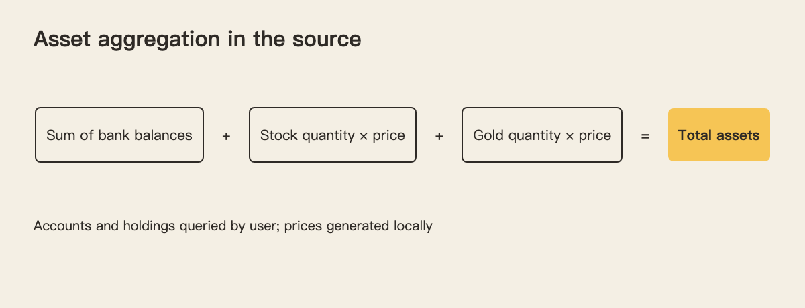

<picture>
  <source media="(prefers-color-scheme: dark)" srcset="readme-assets/cover-en-dark.png">
  
</picture>

<p align="center"><a href="课设网页代码3.0/">Source</a> · <a href="项目概况/">Design</a> · <a href="数据流程图/">Data flows</a> · <a href="https://github.com/Ming-Sir-69">Maintainer</a></p>

<p align="center">
<a href="LICENSE"></a>


</p>

<p align="center"><a href="README.md">简体中文</a> · <b>English</b></p>

# IFM Cross-bank Financial Management System

The IFM Cross-bank Financial Management System brings a user’s accounts at multiple banks into one platform, with a design covering cross-bank transfers, stock and gold trading, and total asset aggregation, similar in form to a third-party payment platform. The course implementation uses PHP, JavaScript, CSS and MySQL. The repository contains web source, database scripts, data-flow diagrams and a course report. Operations are simulated in a local database; no live banking or securities trading system is connected.

## Overview

Users register and sign in, add bank accounts through the business modules, and view transfers, holdings and total assets. Account linking means associating records in the course database, not bank authorization or verification of real accounts.

| Module | Course materials | Source |
| --- | --- | --- |
| User management | Registration, sign-in, password reset and profiles | [Sign-in](课设网页代码3.0/登录界面/) · [Users](课设网页代码3.0/用户管理/) |
| Bank transfers | Multiple bank accounts, balance queries, transfers and records | [Transfers](课设网页代码3.0/银行转账/) |
| Stocks | Account addition, purchases, holdings and price generation | [Stocks](课设网页代码3.0/股票管理/) |
| Gold | Account addition, price generation and gold details | [Gold](课设网页代码3.0/黄金管理/) |
| Total assets | Aggregation of bank, stock and gold assets | [Assets](课设网页代码3.0/总资产/) |

The course report includes gold purchase screenshots, but the repository lacks the gold purchase page, the gold account-addition handler and the trade handler. This workflow cannot run.

The transfer code charges a fee of 0.1% of the transfer amount. The schema includes fund information and user fund holding tables, but no corresponding business functionality is implemented.

## Design highlights

- **Multiple accounts per user:** account records link to users; transfer and purchase pages select a funding account.
- **Balances and transfer records:** the transfer handler uses a MySQLi transaction for both balance updates and the transaction record, with rollback on exceptions.<sup>[[1]](#references)</sup>
- **Three asset classes:** bank balances are summed; stock and gold holdings are valued as quantity times the current database price. Their sum is total assets, with composition displayed using Chart.js.<sup>[[2]](#references)</sup>

## Results

The [web source](课设网页代码3.0/), [database schema](课设网页代码3.0/数据库.sql), [data-flow diagrams](数据流程图/) and [course report](<管理信息系统课设说明书 .docx>) retain the materials from business analysis through page implementation.

<picture>
  <source media="(prefers-color-scheme: dark)" srcset="readme-assets/assets-en-dark.png">
  
</picture>

The asset aggregation can be checked directly in the source:

```php
$totalAssets = $bankAssets + $goldAssets + $stockAssets;
```

Source: [asset page](课设网页代码3.0/总资产/总资产界面.php); component calculations: [asset handler](课设网页代码3.0/总资产/总资产处理.php).

## Method

Read in the order of business flows, data tables, then pages and handlers. Start with the [design materials](项目概况/) and [data-flow diagrams](数据流程图/), compare the [schema](课设网页代码3.0/数据库.sql), and trace modules from the [sign-in page](课设网页代码3.0/登录界面/登录/登录界面.php).

Database access uses PHP MySQLi; the connection file contains configuration placeholders.<sup>[[1]](#references)</sup> Before local execution, check PHP extensions, the MySQL version, schema initialization order and seed data, using self-created test accounts. A complete environment version inventory and a standalone Release are not available, so no unverified one-command setup is supplied.

## Limitations

- This is a course artifact without validation for real payments, settlement or financial security. It is not for real-money transactions.
- Stock and gold prices come from local scripts, not live market feeds; total assets reflect the course database's valuations.
- The transfer handler uses transactions, but concurrency, authorization and failure paths have not been fully tested. Transaction usage alone does not establish reliable funds handling.
- The report includes gold purchase screenshots, but the source lacks the purchase page, account-addition handler and trade handler; this workflow cannot run.
- The administrator interface is a placeholder page and is not implemented.
- The system has not completed end-to-end runtime acceptance.
- SQL, images and attachments retain existing materials. Check their provenance and sharing scope before reuse; do not import real customer data.

## Acknowledgements

The project uses PHP/MySQLi and Chart.js. Collaborative course materials retain their original attribution; documentation maintenance does not reassign authorship.

The cover illustration was generated by an image-generation model and processed for this project. ICBC, HSBC, Citi and BOC identify bank buildings in the illustration only; they imply no API integration, partnership or endorsement.

## References

1. PHP Documentation Group. *PHP Manual: MySQL Improved Extension*, online manual; the project runtime version is not pinned. [MySQLi](https://www.php.net/manual/en/book.mysqli.php). Corresponds to database connections, prepared statements and transaction APIs in the source.
2. Chart.js contributors. *Chart.js Documentation*, online documentation; the source CDN dependency is not version-pinned. [Documentation](https://www.chartjs.org/docs/latest/). Corresponds to the asset composition chart.

## Related research

This paper provides context for data organization, not a claimed implementation source for the course code.

- Codd, E. F. (1970). *A Relational Model of Data for Large Shared Data Banks*. Communications of the ACM, 13(6), 377–387. [DOI](https://doi.org/10.1145/362384.362685). Relates to joining user, account, holding and price tables for asset aggregation.

## Repository structure

| Path | Contents |
| --- | --- |
| `课设网页代码3.0/` | PHP pages, JavaScript, CSS and SQL |
| `项目概况/` | Functional and database materials, directory notes and PlantUML text |
| `数据流程图/` | JPG diagrams and Visio source files |
| `管理信息系统课设说明书 .docx` | Course report |
| `readme-assets/` | Chinese/English light/dark covers and existing headers |

---

Maintained by <picture><source media="(prefers-color-scheme: dark)" srcset="readme-assets/em-logo-dark.svg"></picture> <b>EricMingle69</b> · <a href="https://github.com/Ming-Sir-69">Ming-Sir-69</a><br>
License: [Apache-2.0](LICENSE); component attribution and permissions: [maintenance and permissions notice](PERSONAL-NOTICE.md).
