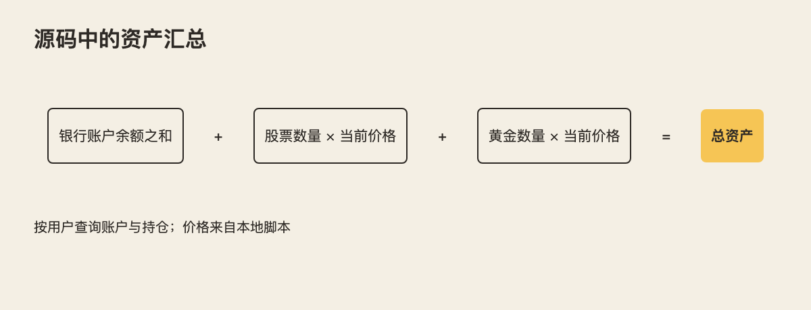

<picture>
  <source media="(prefers-color-scheme: dark)" srcset="readme-assets/cover-zh-dark.png">
  
</picture>

<p align="center"><a href="课设网页代码3.0/">网页源码</a> · <a href="项目概况/">设计材料</a> · <a href="数据流程图/">数据流程图</a> · <a href="https://github.com/Ming-Sir-69">维护者主页</a></p>

<p align="center">
<a href="LICENSE"></a>


</p>

<p align="center"><b>简体中文</b> · <a href="README.en.md">English</a></p>

# IFM 跨银行金融管理系统

本项目（IFM 跨银行金融管理系统）把用户在多家银行的账户集中到一个平台，设计跨行转账、股票与黄金交易和总资产汇总，形式类似第三方支付平台。课程实现使用 PHP、JavaScript、CSS 与 MySQL。本仓库保存网页源码、数据库脚本、数据流程图与课程说明书；业务在本地数据库内模拟，未接入真实银行或证券交易系统。

## 概述

用户从注册、登录进入平台，在各业务的账户添加入口登记银行账户，再查看转账、持仓与总资产。账户绑定指课程数据库中的账户关联，不代表银行授权或真实账户验证。

| 模块 | 课程材料中的内容 | 源码入口 |
| --- | --- | --- |
| 用户管理 | 注册、登录、密码重置、资料管理 | [登录](课设网页代码3.0/登录界面/) · [用户管理](课设网页代码3.0/用户管理/) |
| 银行转账 | 多行账户添加、余额查询、转账与记录 | [银行转账](课设网页代码3.0/银行转账/) |
| 股票管理 | 账户添加、股票购买、持仓与价格生成 | [股票管理](课设网页代码3.0/股票管理/) |
| 黄金管理 | 账户添加、价格生成与黄金详情 | [黄金管理](课设网页代码3.0/黄金管理/) |
| 总资产 | 银行、股票与黄金三类资产汇总 | [总资产](课设网页代码3.0/总资产/) |

说明书含黄金购买截图，但仓库源码缺少黄金购买页、黄金账户添加处理和成交处理，该链路无法运行。

转账代码按转账金额收取 0.1% 手续费。建表脚本含基金信息与用户基金持有表，但没有对应业务功能。

## 设计要点

- **一个用户关联多个账户**：账户记录关联用户，转账与购买页面从账户中选择资金来源。
- **转账记录与余额更新**：转账处理以 MySQLi 事务提交两侧余额更新及交易记录，异常时调用回滚。<sup>[[1]](#参考文献)</sup>
- **三类资产统一展示**：银行余额相加；股票与黄金分别按持有数量乘以数据库当前价格估值，再相加得到总资产。页面使用 Chart.js 展示资产构成。<sup>[[2]](#参考文献)</sup>

## 成果展示

[网页源码](课设网页代码3.0/)、[数据库结构](课设网页代码3.0/数据库.sql)、[数据流程图](数据流程图/)与[课程说明书](<管理信息系统课设说明书 .docx>)保留了从业务分析到页面实现的材料。

<picture>
  <source media="(prefers-color-scheme: dark)" srcset="readme-assets/assets-zh-dark.png">
  
</picture>

资产汇总的实现可直接对照以下源码：

```php
$totalAssets = $bankAssets + $goldAssets + $stockAssets;
```

来源：[总资产界面](课设网页代码3.0/总资产/总资产界面.php)，各分项计算见[总资产处理](课设网页代码3.0/总资产/总资产处理.php)。

## 方法

按“业务流程 → 数据表 → 页面与处理脚本”阅读：先看[项目概况](项目概况/)和[数据流程图](数据流程图/)，再对照[建库脚本](课设网页代码3.0/数据库.sql)，最后从[登录页面](课设网页代码3.0/登录界面/登录/登录界面.php)追踪各模块。

数据库访问使用 PHP MySQLi；连接文件使用配置占位符。<sup>[[1]](#参考文献)</sup> 本地运行前需核对 PHP 扩展、MySQL 版本、建库顺序与初始数据，使用自行构造的测试账户。仓库尚无完整的环境版本清单或独立 Release，不提供未经验证的一键启动步骤。

## 局限

- 本项目是课程作品，未完成真实支付、清算或金融安全验证，不用于真实资金交易。
- 股票与黄金价格由本地脚本生成，不是实时行情；资产汇总是课程数据库的估值。
- 转账代码使用事务，但并发、权限与异常路径未经过完整测试，不能据此认定资金处理可靠。
- 说明书含黄金购买截图，但源码缺少黄金购买页、黄金账户添加处理和成交处理，该链路无法运行。
- 管理员界面仅为占位页，未实现。
- 系统尚未完成端到端运行验收。
- SQL、图片和附件保留原有材料；复用前需核对数据来源与分享范围，不导入真实客户资料。

## 致谢

本项目使用 PHP/MySQLi 与 Chart.js。课程协作材料保留原有归属，文档维护署名不改署原作品。

封面插画由图像生成模型生成，经本项目处理。ICBC、HSBC、Citi、BOC 仅用于识别插画中的银行建筑，不代表接口接入、合作或背书。

## 参考文献

1. PHP Documentation Group. *PHP Manual: MySQL Improved Extension*，在线手册，项目运行版本未锁定。[MySQLi](https://www.php.net/manual/en/book.mysqli.php)。对应源码中的数据库连接、预处理语句与事务接口。
2. Chart.js contributors. *Chart.js Documentation*，在线文档，源码 CDN 未锁定版本。[文档](https://www.chartjs.org/docs/latest/)。对应总资产页面的资产构成图。

## 相关研究

以下文献用于理解数据组织机制，不作为本课程代码的已用实现依据。

- Codd, E. F. (1970). *A Relational Model of Data for Large Shared Data Banks*. Communications of the ACM, 13(6), 377–387. [DOI](https://doi.org/10.1145/362384.362685)。对应本项目用用户、账户、持仓和价格表关联查询并汇总资产的机制。

## 仓库结构

| 路径 | 内容 |
| --- | --- |
| `课设网页代码3.0/` | PHP 页面、JavaScript、CSS 与 SQL |
| `项目概况/` | 功能与数据库材料、目录说明、PlantUML 文本 |
| `数据流程图/` | JPG 图与 Visio 源文件 |
| `管理信息系统课设说明书 .docx` | 课程说明书 |
| `readme-assets/` | 中英亮暗封面与既有页眉 |

---

文档维护：**✦ EricMingle69** · [Ming-Sir-69](https://github.com/Ming-Sir-69)  
许可：[Apache-2.0](LICENSE)；各组成部分的归属与权限见[个人维护与授权说明](PERSONAL-NOTICE.md)。
